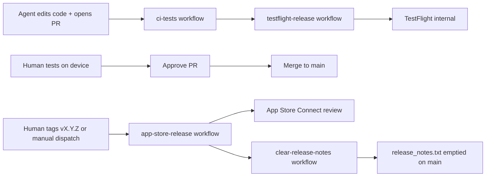

# CI and delivery

How GitHub Actions builds, tests, previews, and releases the app. Read before changing a workflow, a Fastlane lane, or the signing and secret setup.

## Pipelines

| Stage | Trigger | What runs | Human |
|-------|---------|-----------|-------|
| Fast feedback | PR push or push to `main` | `ci-tests` runs `ci_tests`: both test targets, coverage gate, warnings report | Optional |
| Feature validation | Successful completion of `ci-tests` on a PR (default) | `testflight-release` runs match → build → **TestFlight internal** | **Test on device** before approving the PR |
| Store release | Push tag `v*` (for example `vX.Y.Z`) or **Actions → App Store Release → Run workflow** with a version | Upload and **submit for review**; **automatic release** after Apple approves | Monitor in App Store Connect (no manual Release click) |
| Store release cleanup | Successful **App Store Release** run | `clear-release-notes` truncates `release_notes.txt` on `main` in one bot commit with `[skip ci]` | Optional |

The **`no-deploy`** label skips signing and the TestFlight upload for that PR; `testflight-release` still runs and comments that the upload was skipped.

A run with a PR is named `TestFlight — PR <number>`, from the manual `pr_number` input or the `workflow_run` payload, even though a chained run's own ref says `main`. A chained run whose CI failed is named the same way but skipped by the job guard. A chained run whose payload carries no PR is named `TestFlight — <head branch>`; it produces no build: a successful same-repo PR run fails in `Resolve PR context`, and a push to `main` is skipped by the job guard.

For a PR without `no-deploy`, the PR comment bot posts the workflow run number (labeled `Build number` in its comment) and a run link. The uploaded build number is the `Build number N` line in the Actions log, or the `using BUILD_NUMBER` line if the App Store Connect lookup fails; reference that in review notes.

## Secrets (humans only)

Stored in GitHub → Settings → Secrets and variables → Actions. Agents reference secret **names** only; never print or commit values.

| Secret | Purpose |
|--------|---------|
| `MATCH_PASSWORD` | Decrypt match cert repo |
| `MATCH_GIT_PRIVATE_KEY` | SSH deploy key (read cert repo) |
| `MATCH_GIT_URL` | `git@github.com:…/musicwall-match-certs.git` |
| `APP_STORE_CONNECT_API_KEY_KEY_ID` | App Store Connect API |
| `APP_STORE_CONNECT_API_KEY_ISSUER_ID` | App Store Connect API |
| `APP_STORE_CONNECT_API_KEY_CONTENT` | Base64 `.p8` key |

## Before marking work complete

1. Confirm `ci-tests` passes before relying on `testflight-release`, or explain why `no-deploy` is appropriate.
2. Note any MusicKit or device-only verification for the human.
3. **Workflow evidence** means the Actions run log and the bot's run link; TestFlight processing and App Store submission status come from App Store Connect.

## Common failures

| Symptom | Likely cause |
|---------|----------------|
| match fails on CI | Wrong `MATCH_PASSWORD` or deploy key |
| No profiles for MusicWall | MusicKit capability missing on the App ID; re-run match on a Mac |
| Upload rejected as a duplicate build | Build number collision — CI must increment `CFBundleVersion` |
| Music works in the simulator but not TestFlight | Test the **internal TestFlight** build, not the simulator |
