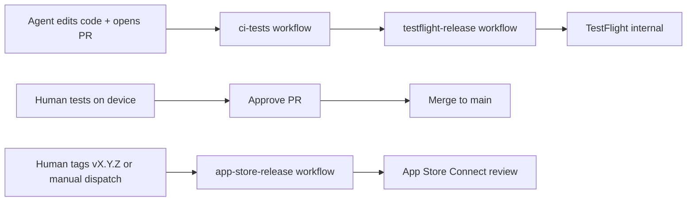

# CI and delivery

How GitHub Actions builds, tests, previews, and releases the app. Read before changing a workflow, a Fastlane lane, or the signing and secret setup.

## Pipelines

| Stage | Trigger | What runs | Human |
|-------|---------|-----------|-------|
| Fast feedback | PR push or push to `main` | `ci-tests` runs `ci_tests`: both test targets, coverage gate, warnings report | Optional |
| Feature validation | Successful completion of `ci-tests` on a PR (default) | `testflight-release` runs match → build → **TestFlight internal** | **Test on device** before approving the PR |
| Store release | Push tag `v*` (for example `vX.Y.Z`) or **Actions → App Store Release → Run workflow** with a version | Upload and **submit for review**; **automatic release** after Apple approves | Monitor in App Store Connect (no manual Release click) |

A docs-only or trivial change should carry the **`no-deploy`** label so the TestFlight upload is skipped. After implementation, the PR comment bot posts the TestFlight build number and status; reference that number in review notes.

## Secrets (humans only)

Stored in GitHub → Settings → Secrets and variables → Actions. Agents reference secret **names** only; never print or commit values.

| Secret | Purpose |
|--------|---------|
| `MATCH_PASSWORD` | Decrypt match cert repo |
| `MATCH_GIT_PRIVATE_KEY` | SSH deploy key (read cert repo) |
| `MATCH_GIT_URL` | `git@github.com:…/musicwall-match-certs.git` |
| `APP_STORE_CONNECT_API_KEY_KEY_ID` | App Store Connect API |
| `APP_STORE_CONNECT_API_KEY_ISSUER_ID` | App Store Connect API |
| `APP_STORE_CONNECT_API_KEY_CONTENT` | Base64 `.p8` key |

## Before marking work complete

1. Confirm `ci-tests` passes before relying on `testflight-release`, or explain why `no-deploy` is appropriate.
2. Note any MusicKit or device-only verification for the human.
3. Never claim TestFlight or App Store success without workflow evidence.

## Common failures

| Symptom | Likely cause |
|---------|----------------|
| match fails on CI | Wrong `MATCH_PASSWORD` or deploy key |
| No profiles for MusicWall | MusicKit capability missing on the App ID; re-run match on a Mac |
| Upload rejected as a duplicate build | Build number collision — CI must increment `CFBundleVersion` |
| Music works in the simulator but not TestFlight | Test the **internal TestFlight** build, not the simulator |
